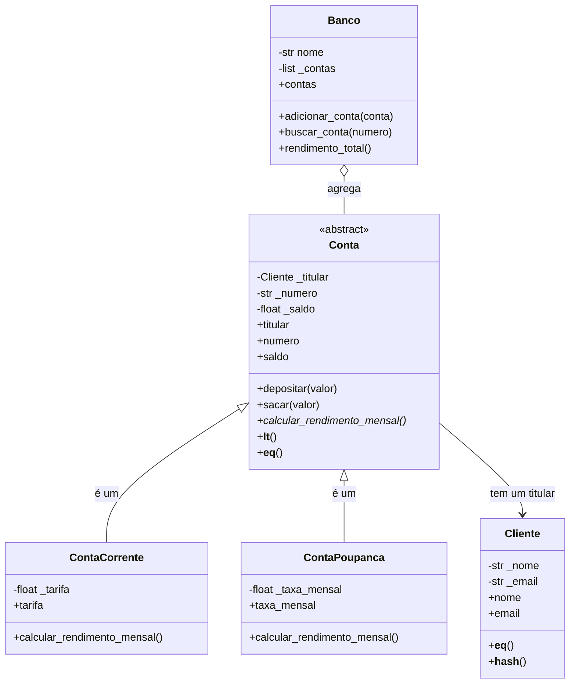

# Semana 6 – Sistema Bancário em POO (Python)

O `sistema_bancario.py` modela clientes, contas e um banco usando classes, herança, classe abstrata, encapsulamento com `@property`, polimorfismo e métodos especiais. O script cria 11 objetos válidos, faz operações, mostra o polimorfismo e trata as entradas inválidas.

## Como executar

```bash
python sistema_bancario.py
```

## Diagrama de classes



Os métodos marcados com `*` são abstratos: `Conta` não pode ser instanciada diretamente.

## Justificativa das decisões de modelagem

**Herança (`Conta` → `ContaCorrente` e `ContaPoupanca`).** Uma conta corrente *é uma* conta, e uma poupança também. Os dados comuns (titular, número, saldo, depósito e saque) ficam em `Conta`, para não repetir código. Cada subclasse só acrescenta o que é específico: a tarifa na corrente e a taxa de rendimento na poupança.

**Classe abstrata (`Conta`).** `calcular_rendimento_mensal()` é declarado com `@abstractmethod`. Isso obriga toda conta concreta a definir o próprio cálculo, e impede criar uma `Conta` genérica sem regra de rendimento.

**Composição (`Conta` tem um `Cliente`; `Banco` agrega `Conta`).** O titular não é herdado: uma conta *tem um* cliente. Usei composição porque um cliente pode ter várias contas e uma conta não é um tipo de cliente. O `Banco` também guarda contas em uma lista interna, sem herdar delas.

**Por que não herança para o `Banco`?** Um banco não é uma conta. Herdar daria a ele métodos que não fazem sentido, como `sacar()`.

## Validações com `@property`

Os atributos ficam protegidos (`_nome`, `_saldo`...) e só mudam pelos setters, que validam antes de guardar. Assim o objeto nunca fica em estado inválido, mesmo que a validação seja feita depois da criação.

| Classe | Atributo | Regra |
|--------|----------|-------|
| `Cliente` | `nome` | não pode ser vazio nem só espaços |
| `Cliente` | `email` | precisa bater com o padrão `[\w.+-]+@[\w-]+(\.[\w-]+)+` |
| `Conta` | `numero` | não pode ser vazio |
| `Conta` | `saldo` | não pode ser negativo (impede saldo negativo) |
| `Conta` | `titular` | somente leitura; precisa ser um `Cliente` no `__init__` |
| `ContaCorrente` | `tarifa` | não pode ser negativa |
| `ContaPoupanca` | `taxa_mensal` | precisa estar entre 0 e 1 (0% a 100%) |

As regras de depósito e saque (valor maior que zero, saque não maior que o saldo) ficam nos métodos `depositar()` e `sacar()`. O saque acima do saldo levanta `SaldoInsuficienteError`, uma exceção própria que herda de `Exception`.

## Métodos especiais

- `__init__`: em todas as classes. As filhas chamam `super().__init__(...)`.
- `__str__`: amigável, e sobrescrito nas contas para mostrar o tipo.
- `__repr__`: em `Cliente`, `Conta` e `Banco`, para depuração.
- `__eq__` e `__hash__`: `Cliente` é igual pelo e-mail; `Conta` é igual pelo número. Não duplica contas no `Banco`.
- `__lt__`: compara contas pelo saldo, então `sorted(banco.contas)` funciona.

## Exemplo de uso

```python
ana = Cliente("Ana Souza", "ana@email.com")
conta = ContaCorrente(ana, "1001", saldo=500)

conta.depositar(100)
conta.sacar(50)
print(conta)  # Conta corrente 1001 | Ana Souza | R$ 550.00

try:
    conta.sacar(999999)
except SaldoInsuficienteError as erro:
    print(erro)  # saldo de R$ 550.00 insuficiente para sacar R$ 999999.00
```

## Polimorfismo

`banco.contas` mistura `ContaCorrente` e `ContaPoupanca`. O mesmo laço chama `calcular_rendimento_mensal()` em todas, e cada classe responde do seu jeito:

```python
for conta in banco.contas:
    print(f"{conta} -> rendimento: R$ {conta.calcular_rendimento_mensal():+.2f}")
```

## Saída do script

```text
Banco criado: Banco Exemplo (6 contas)
Clientes: ['Ana Souza <ana@email.com>', 'Bruno Lima <bruno@email.com>', 'Carla Dias <carla@email.com>', 'Diego Mota <diego@email.com>']

Após depósito de 100 e saque de 50: Conta corrente 1001 | Ana Souza | R$ 550.00

Contas e rendimento mensal:
  Conta corrente 1001 | Ana Souza | R$ 550.00 -> rendimento: R$ -15.00
  Poupança 1002 | Ana Souza | R$ 2000.00 -> rendimento: R$ +10.00
  Conta corrente 2001 | Bruno Lima | R$ 150.00 -> rendimento: R$ -15.00
  Poupança 2002 | Bruno Lima | R$ 800.00 -> rendimento: R$ +4.80
  Conta corrente 3001 | Carla Dias | R$ 0.00 -> rendimento: R$ -15.00
  Poupança 4001 | Diego Mota | R$ 10000.00 -> rendimento: R$ +50.00

Rendimento total do banco: R$ +19.80

Contas ordenadas pelo saldo:
  3001: R$ 0.00
  2001: R$ 150.00
  1001: R$ 550.00
  2002: R$ 800.00
  1002: R$ 2000.00
  4001: R$ 10000.00

Busca pela conta 2002: Poupança 2002 | Bruno Lima | R$ 800.00
Busca pela conta 9999: None

Entradas inválidas:
  [e-mail inválido] ValueError: e-mail inválido: 'eva@dominio'
  [saldo negativo] ValueError: saldo não pode ser negativo: -10
  [titular não é Cliente] TypeError: titular deve ser um Cliente
  [depósito zero] ValueError: valor do depósito deve ser maior que zero
  [saque acima do saldo] SaldoInsuficienteError: saldo de R$ 550.00 insuficiente para sacar R$ 999999.00
  [taxa de poupança acima de 100%] ValueError: taxa mensal deve estar entre 0 e 1: 2
  [conta com número repetido] ValueError: conta 1001 já cadastrada
  [classe abstrata] TypeError: Can't instantiate abstract class Conta without an implementation for abstract method 'calcular_rendimento_mensal'
```
